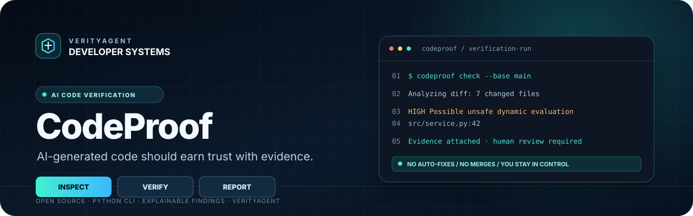
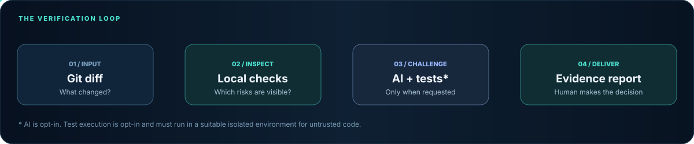
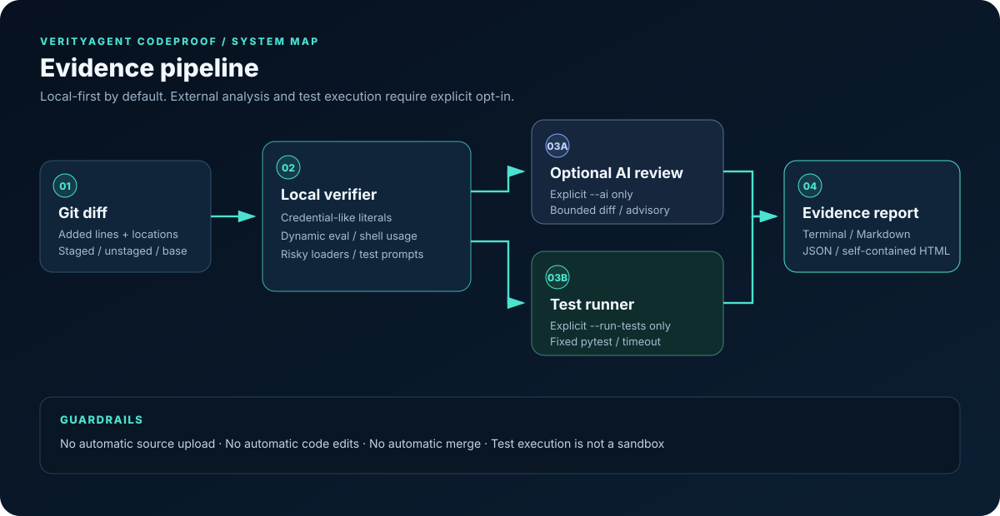

  
   
  
  
  
  
    
  <strong>AI-generated code should earn trust with evidence — not confidence.</strong>
   
  Open-source code verification agent · Python CLI · Human-controlled by design

---

## The idea

**VerityAgent CodeProof** is an evidence-first verification agent for developers working with AI-generated code. It inspects a Git diff, highlights high-signal risk patterns with exact line references, can run the project's tests when explicitly requested, optionally asks an LLM for a second opinion, and exports an auditable report.

CodeProof is deliberately **not another code-writing assistant** and does not claim that an AI review can prove software correct. Its job is to make verification easier to inspect, repeat, and discuss.

<table>
  <tr>
    <td width="33%" valign="top"><strong>01 · Inspect</strong> Analyze added lines and identify concrete risk indicators.</td>
    <td width="33%" valign="top"><strong>02 · Verify</strong> Run pytest only when requested, with a fixed command and bounded timeout.</td>
    <td width="33%" valign="top"><strong>03 · Explain</strong> Export a reviewable report with evidence, recommendations, and limitations.</td>
  </tr>
</table>

## See the verification loop

Explore the [animated interactive walkthrough](docs/demo.html) and [sample terminal report](docs/assets/terminal-report.svg).

**The principle:** every finding should point to evidence. AI-generated suggestions stay advisory; test results are reported separately from static heuristics.

## What it does today

| Capability | In this release |
|---|---|
| Git diff review | Committed changes against a base ref, plus staged and unstaged changes |
| Explainable static heuristics | Detects credential-like literals, dynamic evaluation, shell=True, risky pickle/YAML loaders, and swallowed exceptions in added Python lines |
| Test-run control | Does not execute repository tests by default; the --run-tests flag opts in |
| Optional AI reviewer | OpenAI-compatible endpoint, enabled only with --ai; source is never sent by default |
| Report formats | Terminal, Markdown, JSON, and self-contained HTML |
| CI integration | GitHub Actions test matrix and an optional CodeProof pull-request report workflow |
| Demo fixture | Synthetic diff that shows what evidence-linked findings look like |
| Human approval | No automatic code edits, commits, or merges |

These first-release checks are intentionally focused. They are not a complete security scanner, not whole-program analysis, and not a proof of correctness. The risk score is a transparent heuristic sum, **not a probability of a defect**.

## Quick start

### Requirements

- Python 3.10+
- Git
- pytest is needed only if you request test execution; install the development extra for tests and linting.
- An API key is optional and is used only with the explicit --ai option.

### Install from a checkout

~~~bash
git clone https://github.com/muhammadsaeed-ai/verity-codeproof.git
cd verity-codeproof

python -m venv .venv
# Linux / macOS
source .venv/bin/activate
# Windows PowerShell: .venv\Scripts\Activate.ps1

python -m pip install --upgrade pip
python -m pip install -e ".[dev]"
~~~

### Review a change

~~~bash
# Inspect staged and unstaged changes in the current worktree.
verity-codeproof check

# Compare your branch to main, including local staged/unstaged changes.
verity-codeproof check --base main

# Explicitly opt in to running this repository's pytest suite.
verity-codeproof check --base main --run-tests

# Save a self-contained HTML report.
verity-codeproof check --base main --format html --output reports/codeproof.html

# Emit machine-readable JSON for automation.
verity-codeproof check --base main --format json --output reports/codeproof.json

# Try the synthetic example without pointing CodeProof at your code.
verity-codeproof demo
~~~

A clean report is not a guarantee that a change is safe. Review the code, the test scope, and the report's limitations before merging.

## Optional AI analysis

AI analysis is **off by default**. When --ai is supplied, CodeProof sends a bounded unified diff to the configured OpenAI-compatible chat-completions endpoint. Do not enable it for proprietary or sensitive code unless your organization's policies permit sending that source to the configured provider.

~~~bash
# Set these in your shell; never commit a real key.
export OPENAI_API_KEY="your-key"
export CODEPROOF_MODEL="gpt-4.1-mini"

verity-codeproof check --base main --ai --format markdown --output codeproof-report.md
~~~

Supported environment variables:

| Variable | Purpose | Default |
|---|---|---|
| OPENAI_API_KEY or CODEPROOF_API_KEY | Provider credential | None |
| CODEPROOF_MODEL | Model identifier | gpt-4.1-mini |
| CODEPROOF_BASE_URL | OpenAI-compatible API base URL | https://api.openai.com/v1 |

The AI reviewer treats code as untrusted input, requests JSON, caps the diff sent, and labels its results as advisory. An LLM can still miss bugs, hallucinate issues, or misread context. Validate each AI finding yourself.

## How it works

~~~mermaid
flowchart TD
    A[Git diff] --> B[Parse changed lines]
    B --> C[Deterministic heuristics]
    B --> D{User passed --ai?}
    D -- No --> E[No provider request]
    D -- Yes --> F[Bounded optional LLM review]
    C --> G[Evidence-linked findings]
    E --> G
    F --> G
    G --> H{User passed --run-tests?}
    H -- No --> I[Mark tests as not run]
    H -- Yes --> J[Run pytest with timeout]
    I --> K[Terminal / Markdown / JSON / HTML]
    J --> K
~~~

### Finding anatomy

A finding is designed to be actionable rather than dramatic:

- **Location:** source path and line number when available.
- **Evidence:** the added line or a concise excerpt.
- **Severity:** a triage label from a finite vocabulary.
- **Recommendation:** a next step to validate or remediate the concern.
- **Source and confidence:** distinguish deterministic heuristics from optional AI suggestions.

## Safety and privacy by design

- **No source upload by default.** Provider traffic occurs only with --ai.
- **No test execution by default.** --run-tests is an explicit opt-in.
- **No shell command constructed from project input.** Git and pytest are invoked as argument lists, not through a shell.
- **No automatic edits or merges.** CodeProof reports; a person decides.
- **Test execution is not sandboxed.** A test suite can still run arbitrary Python code. Inspect unfamiliar projects and use a disposable container or VM.
- **Heuristics can be wrong.** False positives and false negatives are expected in this alpha release.
- **Secrets in diffs are sensitive.** Do not send diffs containing secrets to a model. If a real credential was committed, revoke or rotate it.

Read the [threat model](docs/threat-model.md) and [security policy](SECURITY.md) before using CodeProof on sensitive repositories.

## Development

~~~bash
python -m pip install -e ".[dev]"
python -m compileall -q src tests
ruff check src tests
pytest
~~~

The CI workflow runs lint and tests across Python 3.10, 3.11, 3.12, and 3.13. The CodeProof pull-request workflow creates an artifact report; deterministic CI checks remain separate from optional AI analysis.

## Roadmap

- [x] Evidence-linked diff heuristics and severity labels
- [x] Optional AI review, disabled by default
- [x] Explicit test execution with timeout and output capture
- [x] Terminal, Markdown, JSON, and HTML reports
- [x] CI and synthetic bug demo
- [ ] Real mutation-testing engine with isolated workspaces
- [ ] Framework-aware tests and changed-code coverage
- [ ] GitHub Check annotations and review comments
- [ ] Pluggable model providers and local-model support
- [ ] Benchmark suite with labeled, reproducible bug fixtures
- [ ] Sandboxed execution backend and policy controls

Roadmap entries are planned work, not shipped capabilities. Contributions that turn a roadmap item into a tested, documented feature are welcome.

## Contributing

Start with [CONTRIBUTING.md](CONTRIBUTING.md). Bug reports should include the CodeProof version, a minimal diff, observed output, and expected behavior. Please remove all credentials and private source before sharing examples.

## Project

**VerityAgent CodeProof** is an open-source developer tool built by **VerityAgent**.

- Founder & Owner: **Mohammed Saeed**
- CEO: **Muhammad Hammad Nadeem**
- License: [MIT](LICENSE)
- Security issues: follow [SECURITY.md](SECURITY.md) rather than posting sensitive details in public issues.

If this project is useful, a GitHub star helps other developers discover the tool. Please star only if it earns your trust after review.

---

Search topics: AI agent for developers · AI-generated code verification · Python code review CLI · LLM code analysis · automated testing · Git diff analyzer · developer security tooling · test automation · GitHub Actions quality gates · OpenAI-compatible agents · VerityAgent
